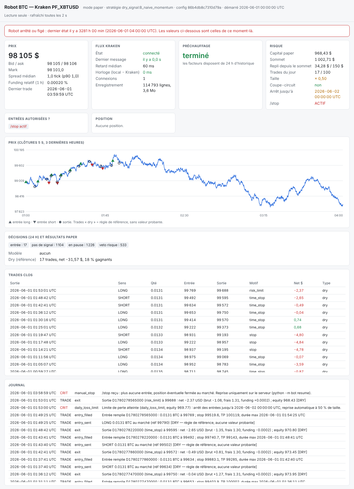

# Robot paper sur PC Windows

Première étape avant le VPS : faire tourner le robot **paper** (aucun ordre réel) sur le PC,
connecté au flux public Kraken, et le suivre en direct dans le navigateur. Le VPS reste la
cible (voir `bot/deploy/RUNBOOK.md`) : un PC s'éteint, se met en veille et redémarre pour ses
mises à jour, ce qui coupe le flux et relance les 25 h de préchauffage.

## 1. Installer (une fois)

Prérequis : Python 3.13 (ou 3.11+) depuis https://www.python.org/downloads/windows/, en cochant
« Add python.exe to PATH », et Git (https://git-scm.com/download/win).

```powershell
git clone -b btc-scalp https://github.com/unsigned-dot/test-agent.git
cd test-agent\btc_scalp
powershell -ExecutionPolicy Bypass -File install.ps1 -Tests
```

Le script crée `.venv` dans le dossier du projet, installe les dépendances, enregistre les
versions exactes dans `requirements-lock-windows.txt`, vérifie la configuration et lance les
tests (environ 3 min). Il ne modifie rien d'autre sur le PC.

## 2. Mesurer l'accès aux données : `sonde_kraken.bat`

Double-cliquer sur `sonde_kraken.bat` (environ 1 à 2 min). Aucune clé API, aucun ordre :
uniquement des lectures publiques espacées. La sonde mesure :

- l'accès à Kraken (production et démo) et à `data.binance.vision` depuis le PC ;
- le tick et le lot de PF_XBTUSD, et le décalage de l'horloge du PC par rapport à Kraken ;
- jusqu'où remonte l'historique de trades Kraken (1 jour à 2 ans) et à quel débit ;
- 30 s de flux WebSocket, avec des exemples bruts de chaque message.

**Envoyer le fichier `runs\kraken_probe_<date>.json` à Claude.** Il décide de la suite :
recherche 100 % Kraken si l'historique couvre au moins 12 mois, sinon recherche sur Binance et
confirmation sur Kraken. Les paramètres de l'endpoint d'historique n'ont pas pu être vérifiés à
l'écriture du script : le rapport contient les réponses brutes pour corriger si besoin.

## 3. Lancer le robot : `lancer_robot.bat`

Double-cliquer sur `lancer_robot.bat`. La fenêtre affiche le journal ; **la laisser ouverte**.
`Ctrl+C` arrête le robot proprement (les fichiers enregistrés sont vidés sur le disque).

- Stratégie `none` par défaut : le robot **n'entre jamais**. Il se connecte, contrôle les
  données et l'horloge, enregistre trades, carnet et ticker dans `var\data\`, et mesure le spread
  réel. C'est exactement ce qu'il faut pour valider les points « démo Kraken » du cahier des
  charges et accumuler des données Kraken.
- Préchauffage de 25 h après chaque démarrage (décision n° 4 validée) : aucune entrée possible
  avant, même avec une stratégie.
- Fichiers : état `var\state.sqlite`, journal `var\log\bot.log`, données `var\data\`.

Pendant que le robot tourne :

- **Veille** : la désactiver sur secteur (Paramètres > Système > Alimentation > « Mettre en
  veille » : Jamais), ou `powercfg /change standby-timeout-ac 0` dans un terminal.
- **Horloge** : le robot se met en pause si l'horloge du PC dérive de plus de 1 s par rapport à
  Kraken. En cas d'alerte `clock_offset`, dans un terminal administrateur : `w32tm /resync`.
- **Windows Update** peut redémarrer le PC : définir des heures d'activité, ou suspendre les
  mises à jour pendant les séances d'enregistrement.
- **Disque** : prévoir 0,5 à 2 Go par jour d'enregistrement (à mesurer la première semaine).

## 4. Voir en direct : `tableau_de_bord.bat`

Double-cliquer sur `tableau_de_bord.bat` : le navigateur s'ouvre sur http://127.0.0.1:8050.
La page se met à jour toutes les 2 s et affiche :

- le prix, le bid/ask, le spread mesuré et le funding horaire ;
- l'état du flux Kraken : connexion, retard, horloge, enregistrement ;
- le compte à rebours du préchauffage ;
- le risque : capital paper, repli depuis le sommet, trades du jour, taille, coupe-circuit, /stop ;
- les raisons pour lesquelles une entrée serait bloquée maintenant ;
- la position ouverte, le graphique des 3 dernières heures, les trades clos et le journal.

Le tableau de bord est **en lecture seule** et tourne dans un processus séparé : on peut le
fermer et le rouvrir à tout moment sans effet sur le robot. Si le robot est arrêté, un bandeau
rouge l'indique et la page montre son dernier état connu. Pour arrêter le robot depuis un
autre terminal : `.venv\Scripts\python -m bot stop` (ou `/stop` sur Telegram).



*Capture sur le faux flux de la démo (données synthétiques, trades « dry » sans valeur probante).*

Pour essayer la page sans réseau, rejouer d'abord un faux flux :

```powershell
.venv\Scripts\python -m bot demo --out var_demo
.venv\Scripts\python -m bot dashboard --state-db var_demo\state.sqlite
```

## 5. Telegram (facultatif)

Créer `%USERPROFILE%\.config\btc_scalp\telegram.env` contenant :

```
BTC_SCALP_TELEGRAM_TOKEN=123456:ABC...
BTC_SCALP_TELEGRAM_CHAT_ID=123456789
```

Obtenir le token et le chat id : voir `bot/deploy/RUNBOOK.md`, section Telegram. Sans ce
fichier, les alertes vont seulement dans le journal et le tableau de bord.

## 6. Passer au VPS plus tard

Le même code tourne sur le VPS (`bot/deploy/install.sh`, service systemd). Les fichiers
enregistrés sur le PC (`var\data\`) peuvent être copiés sur le VPS pour ne pas perdre
l'historique Kraken déjà accumulé. Sur le VPS, le tableau de bord s'ouvre depuis le PC par un
tunnel SSH (voir le RUNBOOK) : il n'est jamais exposé sur internet.
